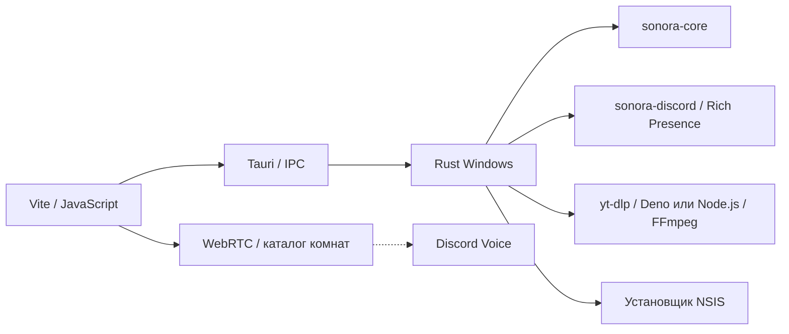

# Sonora для Windows

Sonora — музыкальный плеер для Windows 10/11 x64 с WebView2. Готовые установщики находятся в [Releases](https://github.com/MixiYT/SonoraDesktop/releases).

## Сборка из исходников

Используйте [общий репозиторий исходников](https://github.com/MixiYT/Sonora-development-share). Текущий снимок Windows — 0.5.37. В общем дереве лежат Rust-ядро, Discord IPC, сервер комнат и прокси SoundCloud.

Из каталога `sonora-desktop` установите пакеты через `npm ci` и вызовите `./build-windows.ps1`. Понадобятся Node.js 22.12+, Rust GNU, WinLibs MinGW-w64 и WebView2. Подробности, OAuth и пути к результатам описаны в [руководстве по сборке](https://github.com/MixiYT/Sonora-development-share#сборка-windows).

## Зависимости

См. [подробную карту](https://github.com/MixiYT/Sonora-development-share/blob/main/DEPENDENCY-MAP.md), [файловый индекс](https://github.com/MixiYT/Sonora-development-share/blob/main/docs/dependency-index.md) и [историю изменений](https://github.com/MixiYT/Sonora-development-share/blob/main/CHANGELOG.md).
